# 展序·厦大

**在厦园，让创作被看见。**  
校园艺术与创作平台 · 展览管理与浏览 · Vue 3 + Spring Boot + MySQL

| 管理后台 | Web 端 | 移动端 | 数据与服务 |
| :--- | :--- | :--- | :--- |
| 管理展览与公开状态 | 发现展览、搜索与浏览 | 独立移动 H5 | Spring Boot + MySQL |
| Vue 3 · `:5174` | Vue 3 · `:5173` | Vue 3 · `:5175` | 统一 API · `:8081` |

> **先看演示，再看实现。** 本文包含 **7 张全栈运行截图、3 张公网原型截图、2 张技术说明图**，以及可复用的表单与 JSON 示例。[打开公网交互原型](https://zhanxu-xmu-prototype.vercel.app/)，无需安装环境即可体验；完整后端与数据库流程按启动章节运行。
>
> **图文预览：** GitHub 可直接阅读本文；也可打开 **[readme-preview.html](readme-preview.html)**，在浏览器离线查看完整图文内容。所有图片随项目保存，使用相对路径引用。

| 看产品与演示 | 看设计与工程 | 运行与验收 |
| :--- | :--- | :--- |
| [01 产品与原型](#product) · [02 三端截图](#gallery) | [04 功能与架构](#architecture) · [05 项目结构](#structure) | [07 项目启动](#startup) · [09 验收证据](#verification) |
| [03 操作示例](#demo) | [06 环境要求](#environment) · [08 API 示例](#api) | [10 实现范围](#scope) |

**实现链路：** 后台创建与编辑展览 → MySQL 持久化 → 公开后 Web / H5 同步读取 → 下架后公开列表和详情同时隐藏。

文档与公网原型更新：2026-10-30。全栈数据库功能验收：2026-10-28；公网纯前端独立验收：2026-10-30。两类证据分别记录。

---

<a id="online"></a>

## 在线体验 · 无需安装环境

| Web 展览平台 | 策展管理演示 | 移动 H5 |
| :--- | :--- | :--- |
| [打开 Web 首页 ↗](https://zhanxu-xmu-prototype.vercel.app/) | [进入管理演示 ↗](https://zhanxu-xmu-prototype.vercel.app/admin/) | [打开移动端 ↗](https://zhanxu-xmu-prototype.vercel.app/mobile/) |
| 浏览、搜索、筛选、详情 | 创建、编辑、公开、下架、删除草稿 | 手机布局的列表与详情 |

> **这是已部署的纯前端交互原型。** 管理端点击“进入演示工作台”即可体验，无需账号。数据只保存于当前浏览器；切换顶部 Web / 移动端或刷新页面后查看更改。跨设备、其他浏览器与其他访问者不会共享编辑。顶部“重置演示”恢复初始内容。下文全栈接口与 MySQL 说明对应本地完整工程。


| 公网管理端 · 无需真实账号 | 公网移动端 · 390 × 844 视口 |
| :---: | :---: |
| 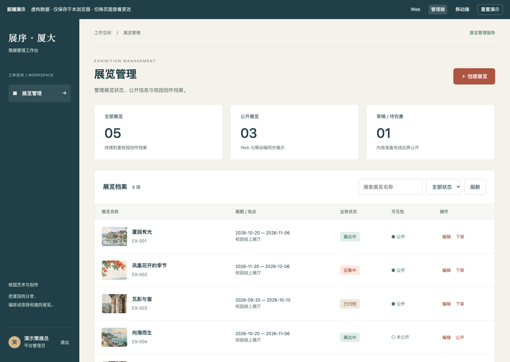 | 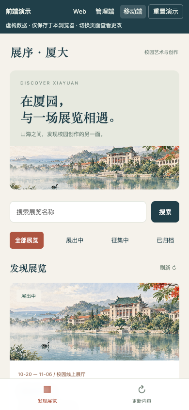 |
| [查看管理端截图原图](docs/images/prototype-admin.png) | [查看移动端截图原图](docs/images/prototype-mobile.png) |

**一条可复现的演示路线：**

1. 打开管理演示，点击“进入演示工作台”，再点击“创建展览”。
2. 使用[下方示例表单](#demo)，业务状态选“展出中”，勾选“向观众公开”，保存。
3. 通过顶部导航切换 Web 或移动端，找到新展览并进入详情。
4. 返回管理端将新展览下架，再刷新公开页面，确认它已隐藏。
5. 点击顶部“重置演示”恢复预置内容。

托管使用 Vercel Hobby 免费方案；未部署后端和数据库。2026-10-30 已用未登录浏览器验证公网三端、创建公开与下架、390 像素布局及无后端请求，见[公网验收结果](tests/prototype-browser-result.json)。[源码与构建说明](prototype/README.md)包含本地预览和发布步骤。

---

<a id="product"></a>

## 01 · 产品与原型

**展序·厦大**面向校园艺术展览与青年创作，帮助策展人员发布展览，也帮助观众发现、浏览和回看校园展览。产品整体原型还包含作品征集、审核、预约与核验；当前实现其中的“展览管理与浏览”模块。

- 原型链接：[展序·厦大 · Figma](https://www.figma.com/design/jfLt6B1elspRvgGAt3ff7P)。链接来自已有项目记录；查看权限由原型文件所有者控制。
- 原型对应：Web 的 W01 首页、W02 展览列表、W03 展览详情；后台的 A02 展览管理、A03 编辑展览；移动端的 M02 发现展览、M03 展览详情。
- 当前实现对原型做了以下调整：列表合并到 Web 首页；管理端增加真实登录与数据库保存；移动端集中展示发现与详情。移除未实现流程的入口，避免把静态按钮当作完成的功能。
- 视觉延续米白纸感背景、湖蓝文字、砖红操作按钮和校园插画。所有素材随工程打包，不依赖在线字体服务。

展览名称、作品、作者及日期均为虚构演示数据，不代表厦门大学的真实展览安排。

<a id="gallery"></a>

## 02 · 三端页面实景

以下图片均来自本工程的实际运行页面。桌面截图保留整页内容；移动端截图使用 **390 × 844** 浏览器视口模拟，不是原型渲染图或真实手机硬件截图。点击图片下方的原图链接可查看完整尺寸。

### A · 管理后台：登录 → 管理 → 编辑

**A1 / 登录策展工作台**  
输入配置中的管理账号与密码，进入后台。登录会话由后端验证；公开端无需登录。

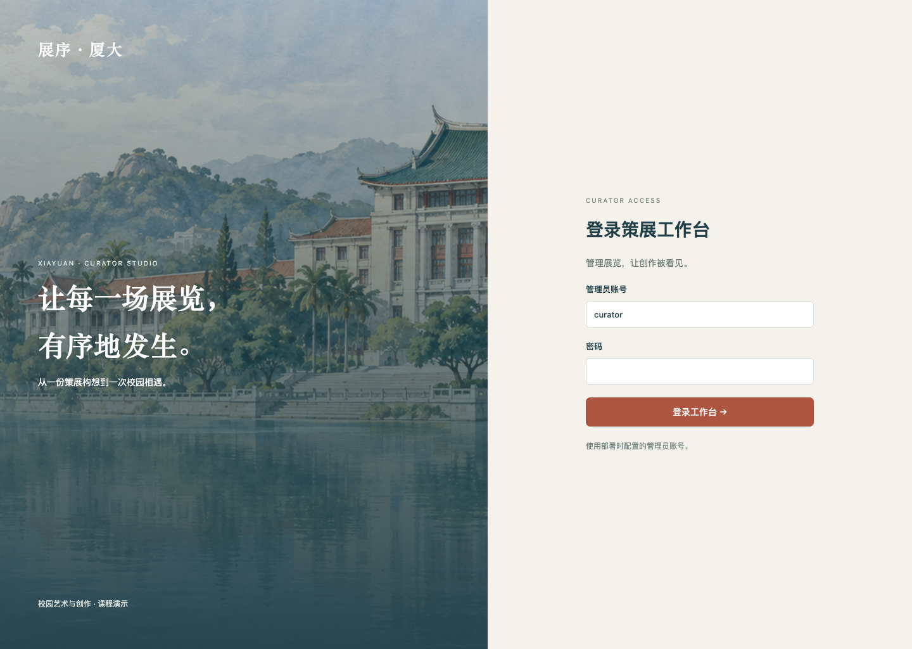

[查看登录页原图](screenshots/01-管理后台-登录.png)

**A2 / 展览管理：统一查看业务状态与可见性**  
列表同时展示展览标题、展期、地点、业务阶段和公开状态。初始演示数据包含 **5 个展览：3 个公开、1 个私有、1 个草稿**；顶部数字来自接口返回的数据。

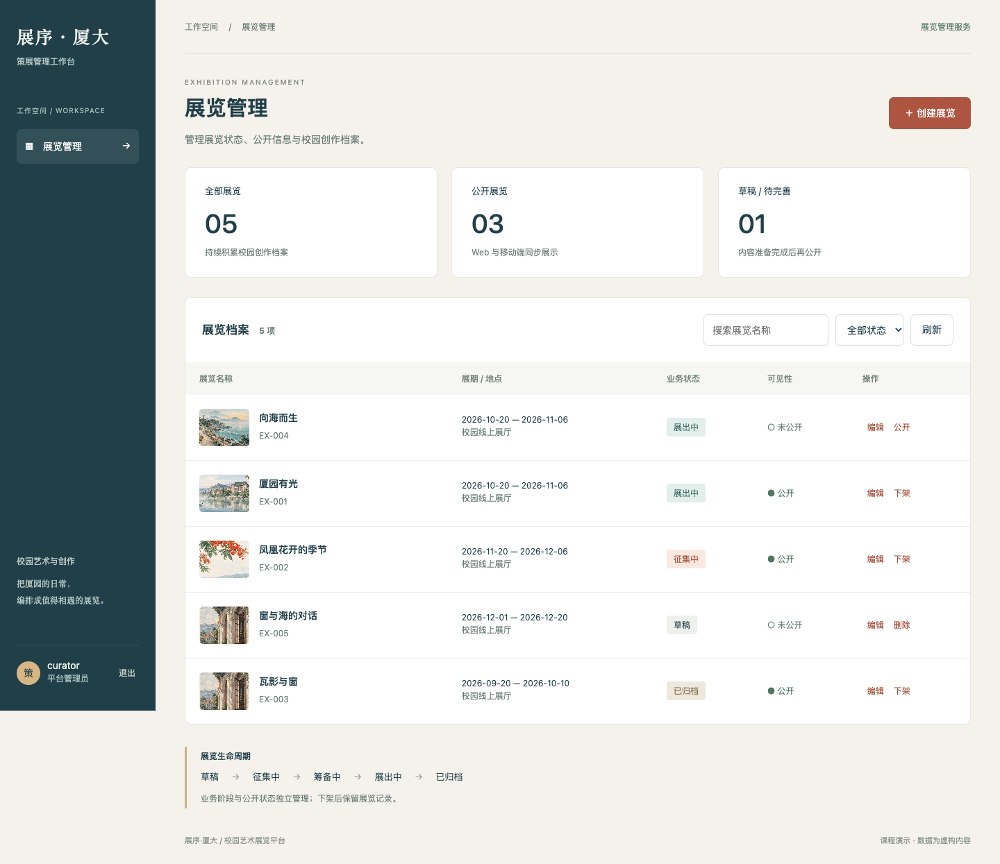

[查看管理页原图](screenshots/02-管理后台-展览管理.png)

| 界面区域 | 演示时操作 | 能验证什么 |
| --- | --- | --- |
| 名称搜索、状态筛选 | 输入“厦园”，或选择“展出中” | 在管理列表定位对应记录 |
| 编辑 | 点击“厦园有光”这一行的“编辑” | 查看并修改完整展览信息 |
| 公开 / 下架 | 开启或关闭观众可见状态 | 同一记录在公开端的可见性发生变化 |
| 删除 | 仅在未公开草稿上点击 | 确认后删除；其他状态保留记录 |

**A3 / 编辑展览：内容、封面、展期与发布设置**  
左侧编辑标题、简介、时间、地点和序言，右侧选择封面、业务阶段与公开开关。保存会请求后端写入 MySQL，刷新后台仍可查看已保存内容。

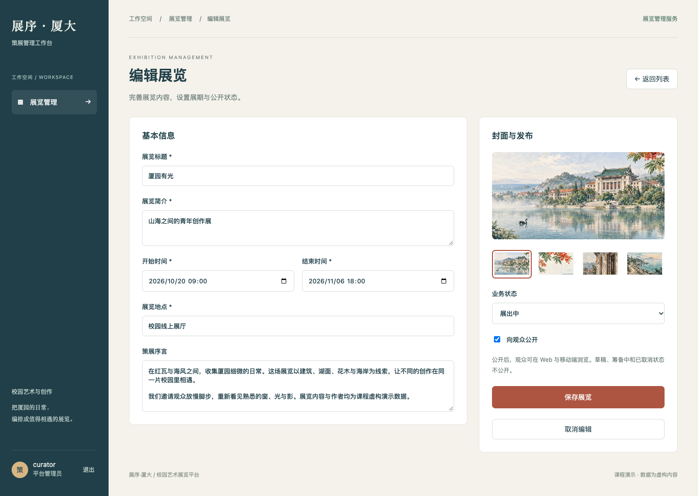

[查看编辑页原图](screenshots/03-管理后台-编辑展览.png)

### B · Web：发现展览 → 阅读详情

**W1 / 首页与展览列表**  
首页延续原型中的校园插画和视觉风格，集中展示公开展览、名称搜索、状态筛选与精选作品。展览卡片可进入详情，精选作品沿用原工程的只读展示。

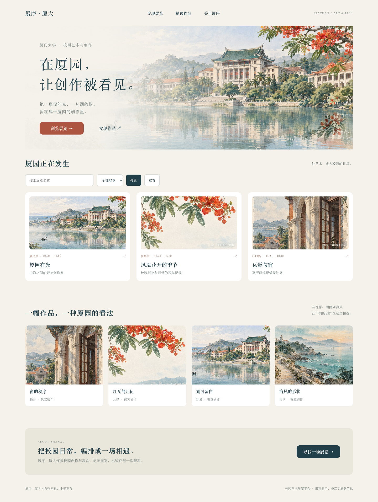

[查看 Web 首页原图](screenshots/04-Web-展览首页.png)

**W2 / 展览详情**  
展示同一条数据库记录的封面、标题、简介、展期、地点与策展序言。详情使用 `#exhibition/{id}` 地址，刷新后仍可恢复对应展览。

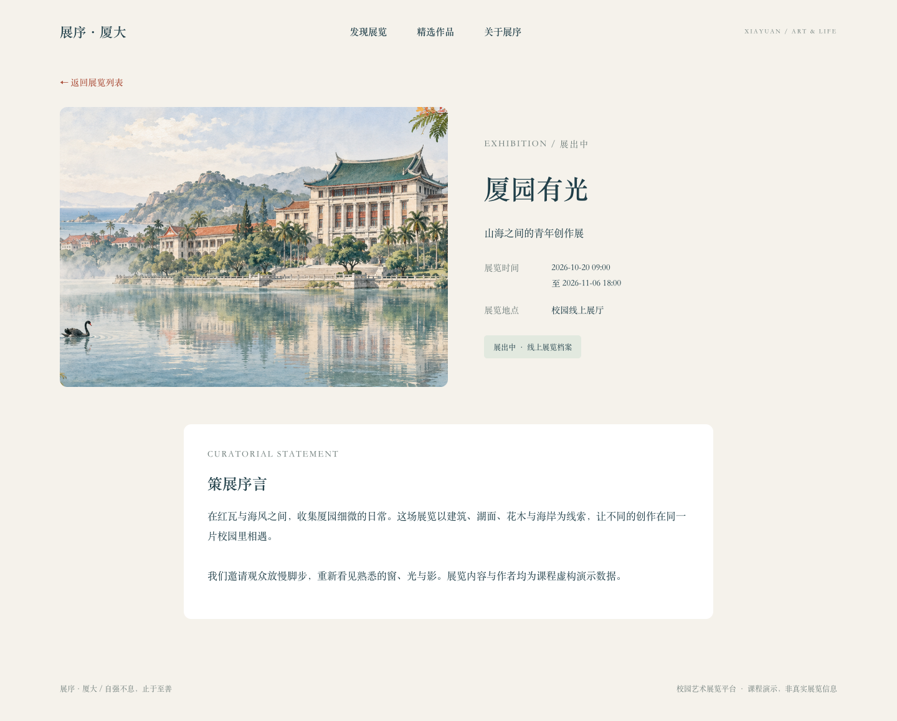

[查看 Web 详情原图](screenshots/05-Web-展览详情.png)

### C · 移动 H5：相同数据，适合手机的阅读顺序

移动端是独立的 Vue 工程，使用单列卡片、筛选按钮、紧凑信息块与底部导航，读取与 Web 相同的公开接口。

| M1 / 发现展览 | M2 / 展览详情 |
| :---: | :---: |
| 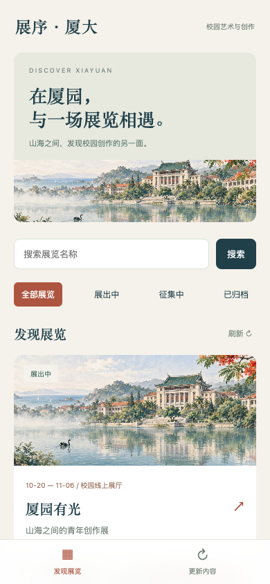 | 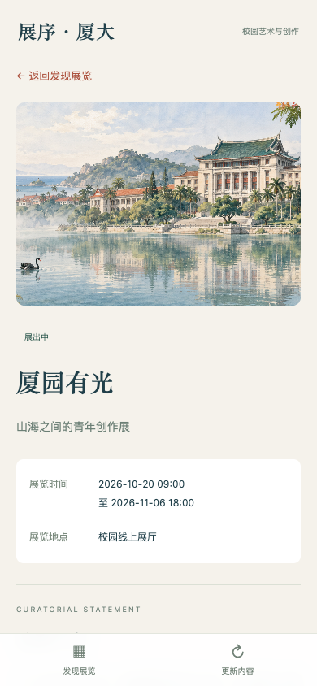 |
| [打开发现页原图](screenshots/06-移动端-发现展览.png) | [打开详情页原图](screenshots/07-移动端-展览详情.png) |

**阅读提示：** 移动截图是单个屏幕视口；实际页面可继续下滑查看其他展览及完整策展序言。

<a id="demo"></a>

## 03 · 从创建到下架：完整操作示例

### 示例表单：创建一场“湖畔光影”展览

以下是一组**可复制的演示输入**，不是预置数据库中已存在的记录。建议创建独立演示展览，避免修改基线数据后影响自动测试。

| 表单项 | 示例输入 |
| --- | --- |
| 标题 / 简介 | **湖畔光影·功能演示** / 以湖面、建筑和校园日常为主题的摄影与视觉创作展。 |
| 展期 | 2026-11-01 09:00 → 2026-11-30 18:00 |
| 地点 / 封面 | 校园线上展厅 / 厦园晨雾 |
| 策展序言 | 从同一片湖畔出发，记录一天中光线与建筑轮廓的变化。本展览仅用于功能演示。 |
| 首次保存 | 业务状态 **草稿**，**不勾选**“向观众公开” |

### 五步演示：从保存到三端联动

| 步骤 | 在哪里操作 | 具体动作 | 预期结果 |
| --- | --- | --- | --- |
| **1 保存草稿** | 管理后台 → 创建展览 | 填写上表并保存，然后刷新后台 | 后台保留记录；公开端不可见 |
| **2 公开展览** | 该记录 → 编辑 | 改为“展出中”，勾选“向观众公开”，保存 | Web / H5 重新查询后出现该展览 |
| **3 核对内容** | Web 与移动 H5 | 搜索“湖畔光影”，进入详情；后台再改序言后刷新两端 | 两端标题、展期和更新后的序言一致 |
| **4 下架展览** | 管理后台 → 下架 | 确认下架，再刷新两端详情 | 列表隐藏；详情提示“展览不存在或尚未公开”；后台保留记录 |
| **5 清理演示** | 该记录 → 编辑 | 改回未公开草稿，保存后删除并确认 | 只删除本次演示记录，恢复原有数据基线 |

### 状态变化一图读懂

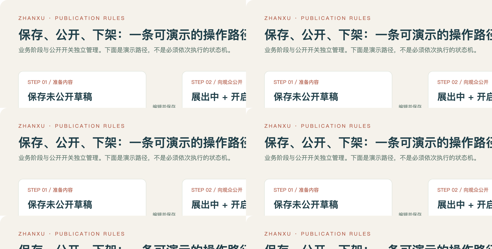

[查看可编辑 SVG 原图](docs/images/publication.svg)

### 异常情况的演示预期

以下是依据后端校验和既有验收记录整理的**预期结果表**，不是新增截图或本次重新执行的测试。

| 输入 / 动作 | 预期结果 | 对应保护 |
| --- | --- | --- |
| 结束时间早于或等于开始时间 | `400`：“结束时间必须晚于开始时间” | 避免无效展期入库 |
| 标题只有空格 | `400`：标题必填提示 | 后端再次检查必填内容 |
| API 请求把草稿设为公开 | `400`：仅指定阶段可公开 | 不依赖前端开关禁用状态 |
| 未登录请求管理列表 | `401`：“请先登录管理后台” | 管理数据访问控制 |
| 访问私有展览 / 删除公开展览 | 详情 `404` / 删除 `409` | 保持公开边界，避免误删 |

<a id="architecture"></a>

## 04 · 功能、架构与业务规则

| 端 | 已实现功能 | 数据来源 |
| --- | --- | --- |
| 管理后台 | 登录/退出、会话恢复、展览统计、名称搜索、状态筛选、新建与编辑、选择封面、公开/下架、删除未公开草稿 | Spring Boot 管理接口与 MySQL |
| Web | 展览列表、名称搜索、状态筛选、展览详情、刷新后恢复详情、精选作品展示、加载/空列表/错误/重试状态 | 公开接口与 MySQL；图片为本地素材 |
| 移动 H5 | 独立移动布局、发现展览、名称搜索、状态筛选、详情、底部导航、手动刷新、错误重试 | 与 Web 相同的公开接口 |

**设计原则：** 三个前端独立构建，后端共用，避免各端保存互相矛盾的展览数据。列表和详情使用同一条公开规则；后台保存后，观众刷新页面或重新查询即可看到变化，不使用 WebSocket 实时推送。

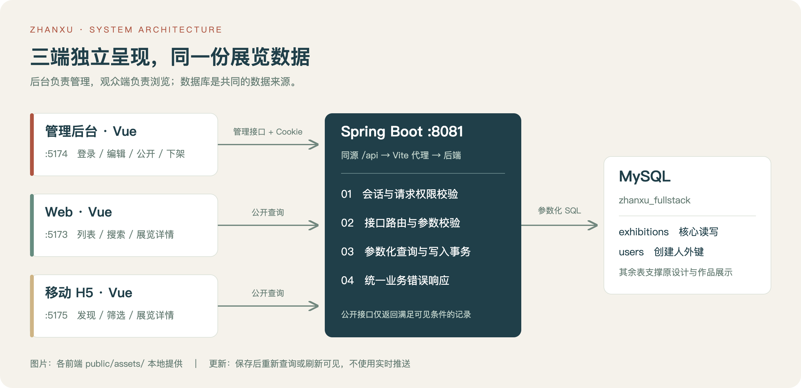

[查看可编辑 SVG 原图](docs/images/architecture.svg)

三端 Vite 将同源 `/api` 请求转发给后端。数据库账号只允许读取数据库和增删改 `exhibitions` 表，不拥有建表、删表权限。管理员身份通过后端环境变量配置；登录后使用服务端会话和 HttpOnly、SameSite=Strict Cookie，30 分钟无活动后过期。写入请求必须携带自定义安全请求头，服务端不开放跨域 CORS。

### 业务规则

1. 标题、简介、地点、封面和开始/结束时间必填；结束时间必须晚于开始时间。后端独立校验，不仅依赖浏览器校验。
2. 业务阶段可选草稿、征集中、筹备中、展出中、已归档、已取消；本次由管理员选择，不按系统时钟自动变化，也不强制逐阶段流转。
3. 只有“征集中、展出中、已归档”允许公开；公开接口同时要求 `public_visible=1`。未公开展览即使知道 ID，详情也返回 404。
4. 下架保留全部记录；物理删除只允许未公开草稿，存在外键关联时返回 409，不级联删除作品或投稿。界面提供删除/下架确认。
5. 封面只允许四张随包素材，避免任意 URL；策展文字用 Vue 文本插值展示，不执行 HTML。管理接口和错误信息不返回数据库密码、SQL 或用户联系方式。


### 从表单到数据库：字段对应关系

| 管理端表单 | API JSON 字段 | MySQL `exhibitions` 字段 | 观众端用途 |
| --- | --- | --- | --- |
| 标题 / 简介 / 序言 | `title` / `introduction` / `statement` | `title` / `introduction` / `curatorial_statement` | 卡片文案与详情正文 |
| 地点 / 封面 | `venue` / `cover` | `venue_label` / `cover_url` | 展览地点与本地图片路径 |
| 开始 / 结束时间 | `startsAt` / `endsAt` | `starts_at` / `ends_at` | 展期展示 |
| 业务阶段 / 公开开关 | `status` / `visible` | `status` / `public_visible` | 状态筛选与公开判定 |
| 自动关联创建人 | 不接受前端指定 | `created_by → users.id` | 本次固定关联演示策展人 `id=1` |

<a id="structure"></a>

## 05 · 项目结构

```text
zhanxu-xmu-fullstack/
├── README.md                     产品、原型、设计、接口与启动说明
├── readme-preview.html           离线图文预览，与 README 同内容
├── docs/
│   ├── images/                   架构/规则图 PNG、SVG，以及 3 张公网截图
│   └── examples/                 草稿与公开展览 JSON 请求体
├── screenshots/                  三端实际运行截图，共 7 张
│   ├── 01-管理后台-登录.png
│   ├── 02-管理后台-展览管理.png
│   ├── 03-管理后台-编辑展览.png
│   ├── 04-Web-展览首页.png
│   ├── 05-Web-展览详情.png
│   ├── 06-移动端-发现展览.png
│   └── 07-移动端-展览详情.png
├── database/
│   ├── schema.sql                MySQL 建库、19 张原有设计表及约束
│   ├── seed.sql                  初始演示展览、作品、策展内容
│   └── create-user.example.sql   应用数据库账号与最小写入权限示例
├── backend/                      Spring Boot 后端工程
│   ├── pom.xml                   Maven 依赖与构建配置
│   ├── .env.example              连接信息与管理账号配置模板
│   └── src/                      Java 接口、查询、校验、鉴权、集成测试
├── admin/                        管理后台 Vue 工程
├── web/                          Web Vue 工程
├── mobile/                       移动 H5 Vue 工程
├── prototype/                    纯前端公网原型入口、演示数据、构建配置与测试
├── tests/                        全栈及公网浏览器脚本、结果与验收说明
├── 墨刀迁移/                     Figma 原型源文件、迁移脚本与校验记录
├── 图像素材/                     原始校园插画与设计素材
├── 预览/                         原型页面预览图
├── build-*.js / figma-kit.js      三端原型与组件库构建脚本
├── prototype-reactions.js        原型交互连线脚本
├── make-demo-qr.swift            演示二维码生成脚本
├── *.json / 执行记录.md          页面、组件、状态定义及设计记录
├── 展序·厦大-数据库设计.sql      原始产品数据库设计
└── SHA256SUMS.txt                项目文件校验清单
```

`admin/`、`web/`、`mobile/` 三个正式前端均含 `src/`、`public/assets/`、`package.json`、`package-lock.json`、`vite.config.js`、`index.html`，可独立安装依赖与启动。仓库不包含 `node_modules`、编译产物、私人 `.env.local`、数据库数据目录及 macOS 资源叉文件。

后端主要文件：`ExhibitionController` 管理路由；`ExhibitionRepository` 执行参数化 SQL 与事务；`AdminAccess` 校验会话和写入请求；`AdminSessionController` 处理登录退出；`ApiErrors` 统一业务异常；`HomeController/Repository/Response` 复用原首页展览与精选作品查询。

数据库沿用原产品 19 表结构以保留原设计关系，实际写入模块为 `exhibitions`，`users` 提供创建人外键。Web 首页精选作品还关联展区、投稿版本和文件表。初始数据为 5 个展览（3 公开、1 私有、1 草稿）及 4 件可公开展示作品，另有隐藏作品用于隔离测试。未实现业务对应的表只保留结构。


> `README.md`、`readme-preview.html`、`screenshots/` 和 `docs/` 使用相对引用。克隆或下载项目时保留目录结构，即可正常查看图片与文档。原型迁移记录反映设计阶段的状态；已实现功能以本 README 的功能说明为准。

<a id="environment"></a>

## 06 · 环境要求

| 工具 | 要求 / 2026-10-28 验证环境 |
| --- | --- |
| Java | JDK 21；实测 21.0.12.1 |
| Maven | 3.6.3 或以上；使用 `pom.xml` 下载依赖 |
| MySQL | 8.0.16 或以上；实测 8.4.11，需支持 CHECK 约束 |
| Node.js / npm | Node.js 22.12 或以上；实测 Node 26.7.0，使用 npm 锁文件安装 |
| 浏览器 | 当前版本 Chrome/Edge；实测 Chrome 桌面与 390×844 移动视口 |

已锁定安装的前端版本为 Vue 3.5.44、Vite 7.3.7；后端为 Spring Boot 3.5.16。首次安装依赖需要网络。运行后不依赖学校认证、第三方云数据库或远程图片服务。

<a id="startup"></a>

## 07 · 项目启动

**启动顺序：数据库 → 后端 → 三个前端。** 以下步骤用于首次运行；仅查看截图与图文说明可直接打开 [离线预览](readme-preview.html)。


### 第一步：导入数据库

启动 MySQL，在**项目根目录**打开终端。下列命令按常见端口 3306 编写；本机演示实例使用 3307，使用其他端口时同步修改命令和 `DB_URL`。

```bash
mysql --protocol=TCP -h127.0.0.1 -P3306 -uroot -p < database/schema.sql
mysql --protocol=TCP -h127.0.0.1 -P3306 -uroot -p < database/seed.sql
```

脚本建立独立数据库 `zhanxu_fullstack`，不会改动已有的 `zhanxu_xmu` 数据库。仅在新的空数据库中导入一次；没有 DROP/TRUNCATE，重复导入会因已有表/主键报错。Windows PowerShell 可使用 `cmd /c "mysql --protocol=TCP -h127.0.0.1 -P3306 -uroot -p < database\schema.sql"`，再对 `seed.sql` 执行相同方式导入；也可以用 MySQL Workbench 的 SQL 编辑器执行文件。

打开 `database/create-user.example.sql`，替换占位密码，再执行：

```bash
mysql --protocol=TCP -h127.0.0.1 -P3306 -uroot -p < database/create-user.example.sql
```

### 第二步：配置并启动后端

复制 `backend/.env.example` 为 `backend/.env.local`。将 `DB_PASSWORD` 改为上一步数据库应用账号的密码，将 `ADMIN_PASSWORD` 设置为自选的至少 12 位密码；两种密码用途不同。管理员账号默认 `curator`，没有随包固定登录密码。

macOS/Linux：

```bash
cd backend
set -a
source .env.local
set +a
mvn verify
java -jar target/zhanxu-backend-1.0.0.jar
```

`mvn verify` 会运行真实 MySQL 集成测试，需先导入初始数据。运行配置只通过环境变量读取，Spring Boot 不会自动加载 `.env.local`，因此 `source` 步骤不能省略。若机器有多个 JDK，先设置 `JAVA_HOME` 指向 JDK 21。也可用 `mvn spring-boot:run` 启动。

Windows PowerShell：在 `backend` 目录手动设置环境变量后运行相同 Maven/Java 命令：

```powershell
$env:DB_URL='jdbc:mysql://127.0.0.1:3306/zhanxu_fullstack?serverTimezone=Asia/Shanghai&characterEncoding=UTF-8'
$env:DB_USERNAME='zhanxu_fullstack_app'
$env:DB_PASSWORD='填写数据库应用账号密码'
$env:ADMIN_USERNAME='curator'
$env:ADMIN_PASSWORD='填写自选的至少12位管理密码'
mvn verify
java -jar target/zhanxu-backend-1.0.0.jar
```

浏览器访问 `http://127.0.0.1:8081/api/exhibitions` 应返回包含 3 个公开展览的 JSON。

### 第三步：启动三个前端

另开三个终端，分别执行下表中的命令（路径相对项目根目录）：

| 端 | 命令 | 地址 |
| --- | --- | --- |
| Web | `cd web`，`npm ci`，`npm run dev` | http://127.0.0.1:5173/ |
| 管理后台 | `cd admin`，`npm ci`，`npm run dev` | http://127.0.0.1:5174/ |
| 移动 H5 | `cd mobile`，`npm ci`，`npm run dev` | http://127.0.0.1:5175/ |

使用 `curator` 和自己配置的 `ADMIN_PASSWORD` 登录管理后台。移动 H5 可在 Chrome 开发者工具设备模式中选择 390×844 视口查看。

如需在真实手机访问，仅将移动前端绑定到局域网：在 `mobile` 中运行 `npm run dev -- --host 0.0.0.0`，手机与电脑连接同一 Wi-Fi，在手机打开 `http://电脑局域网IP:5175/`。后端继续监听电脑本机，由 Vite 代理 API。仅在可信本地网络演示；真实手机访问本次未实测。

### 第四步：构建与停止

各前端目录运行 `npm run build` 生成 `dist/`，之后 `npm run preview` 在原端口预览，需要后端同时运行。不要双击 `index.html`。修改后端端口时，前端可用 `API_TARGET=http://127.0.0.1:新端口 npm run dev` 修改代理。

手动启动时保持四个终端运行，在对应终端按 Ctrl+C 停止；数据库记录仍保留。需要脱离终端运行时，可在服务端使用系统服务管理器或 `nohup`。2026-10-28 的本机验证采用独立后台进程启动；本说明不保证历史服务当前仍在运行。

<a id="api"></a>

## 08 · API 接口与请求响应示例

基地址：`http://127.0.0.1:8081`；JSON 编码 UTF-8；日期格式 `yyyy-MM-dd'T'HH:mm:ss`，按上海本地时间解释。`id` 为数据库主键。本次不支持分页，适用于功能演示数据规模。

| 方法 | 路径 | 用途 / 权限 |
| --- | --- | --- |
| GET | `/api/exhibitions?q=&status=` | 公开展览列表；标题包含搜索、状态过滤 |
| GET | `/api/exhibitions/{id}` | 公开展览详情；私有或不存在返回 404 |
| GET | `/api/home` | 原有首页展览与精选作品数据 |
| POST | `/api/admin/login` | 管理员登录，成功设置会话 Cookie |
| GET | `/api/admin/session` | 读取当前会话，未登录返回 401 |
| POST | `/api/admin/logout` | 注销当前会话 |
| GET | `/api/admin/exhibitions?q=&status=` | 管理员查看全部展览，包括私有和草稿 |
| POST | `/api/admin/exhibitions` | 新建展览，返回 201 与完整记录 |
| PUT | `/api/admin/exhibitions/{id}` | 完整更新展览信息，返回更新后记录 |
| DELETE | `/api/admin/exhibitions/{id}` | 删除未公开且无关联的草稿，返回 204 |

`status` 可选 `draft/collecting/preparing/on_view/archived/cancelled`；公开端仅能返回其中的 `collecting/on_view/archived`。`q` 最多 160 字，使用参数化 SQL 做字面包含搜索。

所有管理写入请求，包括登录和退出，必须带 `X-Zhanxu-Request: 1`。登录以外的管理接口还需有效 Cookie。前端已自动处理，不能只靠隐藏按钮获取权限。

登录请求：

```json
{"username":"curator","password":"你配置的管理密码"}
```

新建/更新请求体（更新时也需提供全部字段）：

```json
{
  "title": "厦园有光",
  "introduction": "山海之间的青年创作展",
  "statement": "在红瓦与海风之间，收集厦园细微的日常。",
  "venue": "校园线上展厅",
  "cover": "/assets/厦园晨雾.png",
  "status": "on_view",
  "visible": true,
  "startsAt": "2026-11-01T09:00:00",
  "endsAt": "2026-11-30T18:00:00"
}
```

返回对象具有上述字段并增加 `id`，列表返回对象数组。`title` 最长 160 字、`introduction` 最长 1000 字、`venue` 最长 255 字、`statement` 最长 5000 字；前三项不允许全空白。封面可用 `厦园晨雾.png`、`凤凰花季.png`、`瓦影.png`、`向海.png`，统一位于 `/assets/` 下。

错误体统一包含 `message`，例如 `{"message":"结束时间必须晚于开始时间"}`。400 表示参数无效；401 表示登录无效/过期；403 表示缺少安全请求头；404 表示记录不存在或未公开；409 表示删除条件不满足或存在数据关联；503 表示数据库暂时不可用。

`/api/home` 是保留的首页接口，返回 `{exhibitions: [...], works: [...]}`；首页推荐最多 3 个展览、4 件作品。完整展览列表与新增展览展示使用 `/api/exhibitions`，不受首页推荐数量限制。


### 示例 A：查询公开展览（无需登录）

在任意终端运行；服务必须已启动。

```bash
curl --get 'http://127.0.0.1:8081/api/exhibitions' \
  --data-urlencode 'q=厦园' \
  --data-urlencode 'status=on_view'
```

初始数据库中将匹配“厦园有光”。列表响应为数组；以下为对应记录的**响应结构示例，序言已节选**：

```json
[
  {
    "id": 1,
    "title": "厦园有光",
    "introduction": "山海之间的青年创作展",
    "statement": "在红瓦与海风之间，收集厦园细微的日常。……",
    "venue": "校园线上展厅",
    "cover": "/assets/厦园晨雾.png",
    "status": "on_view",
    "visible": true,
    "startsAt": "2026-10-20T09:00:00",
    "endsAt": "2026-11-06T18:00:00"
  }
]
```

### 示例 B：导入请求体，创建并公开展览

下载或打开 [草稿请求体](docs/examples/exhibition-draft.json) 和 [公开请求体](docs/examples/exhibition-published.json)。两份文件均是完整 JSON，可复制到 Postman 等接口客户端的 Body → raw → JSON 中，不需要拼接字段。

| 顺序 | 请求 | 请求头 / Body | 预期响应 |
| --- | --- | --- | --- |
| 1 登录 | `POST /api/admin/login` | `Content-Type: application/json`、`X-Zhanxu-Request: 1`；使用前述账号密码 JSON | `200`，客户端保存会话 Cookie |
| 2 新建草稿 | `POST /api/admin/exhibitions` | 同样请求头与会话 Cookie；使用 `exhibition-draft.json` | `201`，记录返回的 `id` |
| 3 公开 | `PUT /api/admin/exhibitions/{返回的id}` | 同样请求头与会话 Cookie；使用 `exhibition-published.json` | `200`，返回 `visible: true` |
| 4 读取详情 | `GET /api/exhibitions/{返回的id}` | 无需登录 | `200`，返回同一展览 |

公开与草稿示例的关键差异（说明片段，不是可单独提交的完整 PUT 请求体）：

```diff
- "status": "draft",
- "visible": false,
+ "status": "on_view",
+ "visible": true,
```

实际 ID 由 MySQL 分配，不应假设它一定是 `6` 或固定数字。测试完成后按[五步演示](#demo)第 5 步清理自己创建的记录。

### 示例 C：错误响应

```http
HTTP/1.1 400 Bad Request
Content-Type: application/json
```

```json
{"message":"结束时间必须晚于开始时间"}
```

这一响应表示保存未通过校验；应修改表单后重新提交。公开详情的 `404` 同时覆盖“记录不存在”和“尚未公开”，避免向观众透露私有记录信息。

<a id="verification"></a>

## 09 · 验收证据与复现

### 已有功能验收：2026-10-28

| 验证层次 | 已保存的结果 | 证据入口 |
| --- | --- | --- |
| 后端与数据库 | 2 个真实 MySQL 集成测试通过；覆盖权限、校验、公开隔离与 CRUD | [验收记录](tests/验收记录.md) · [集成测试源码](backend/src/test/java/cn/edu/xmu/zhanxu/ExhibitionApiTest.java) |
| 三端构建 | 管理后台、Web、移动 H5 生产构建通过 | [验收记录](tests/验收记录.md) |
| 浏览器交互 | UI 创建、公开、两端读取、下架、清理、刷新持久化、错误重试通过 | [浏览器结果 JSON](tests/browser-result.json) · [可复现脚本](tests/e2e.cjs) |
| 截图 | 7 张真实运行截图，桌面与移动视口分别展示 | [三端页面实景](#gallery) |

### 本次公网原型与文档检查：2026-10-30

| 检查对象 | 本次结果 | 证据 |
| --- | --- | --- |
| 公网原型 | Vercel Production 部署 READY；未登录可访问三端 | [在线体验](#online) |
| 演示数据逻辑 | 创建、发布、下架、删除、输入校验、重置通过 | [单元检查](prototype/demo.test.js) |
| 公网浏览器 | 三端操作、详情隔离、手机视口、无后端请求、无脚本或 HTTP 失败 | [结果 JSON](tests/prototype-browser-result.json) · [可复现脚本](tests/prototype-e2e.cjs) |
| 构建与文档 | 纯前端原型与正式管理端构建通过；检查图片、链接和离线预览布局 | [构建说明](prototype/README.md) |

本次未重新运行 Spring Boot / MySQL 集成测试；完整后端测试证据仍使用 2026-10-28 的记录。

### 如何重新验证

后端自动检查：`backend` 中加载环境变量后运行 `mvn verify`。浏览器检查：先启动四个服务，在 `tests` 中运行 `npm ci`、`npx playwright install chromium`、`npm test`。脚本读取 `backend/.env.local`，创建并删除自己的临时记录，验证登录、UI 写入、三端一致性、刷新持久化、搜索/筛选、模拟 503 错误重试，并重新生成截图。若测试中断，控制台会报告未清理的测试展览 ID，按后台常规操作清理即可。

浏览器截图来自真实运行页面；移动截图使用 390×844 视口模拟，不是手机硬件截图。详细结果见 [验收记录](tests/验收记录.md) 和 [浏览器结果](tests/browser-result.json)。不要在已有其他人工演示数据的数据库上直接要求初始数据数量测试通过，建议使用本项目的初始数据库进行验收。

<a id="scope"></a>

## 10 · 实现范围与已知限制

当前已实现“展览管理与浏览”模块。作品投稿、审核编排、预约核验、观众登录、学校身份认证、上传文件和原生 App 不在实现范围内。保留的精选作品只读，管理账号为单一配置账号，新建展览的创建人关联演示策展人 `users.id=1`。

公网仅部署并验证了纯前端原型；未验证 Windows、Safari 和真实手机。Spring Boot / MySQL 完整工程仍用于本机功能演示；若将完整工程部署到公网，需要 HTTPS/Secure Cookie、登录限流、独立用户与角色权限，以及正式反向代理。多人同时编辑同一记录时按最后保存覆盖，本次未实现版本冲突检测。

