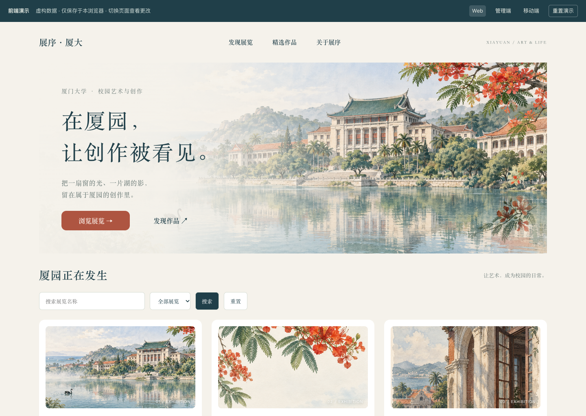

# 展序·厦大 · 完整项目

校园艺术与创作平台的完整课程项目归档：包含原型设计、素材、生成脚本、Figma / 墨刀迁移、早期 Vue 与 Spring Boot 工程、历次作业材料，以及最终的三端全栈实现。

**最终作业入口：[全栈作业提交-2026-10-28 / 图文 README](全栈作业提交-2026-10-28/readme.md)。** 产品介绍、设计思路、三端截图、API、SQL、环境要求与启动步骤均在该目录中；向老师提交时可直接上传这个子文件夹。

## 公网交互原型

| Web | 管理演示 | 移动 H5 |
| --- | --- | --- |
| [浏览展览](https://zhanxu-xmu-prototype.vercel.app/) | [进入策展工作台](https://zhanxu-xmu-prototype.vercel.app/admin/) | [打开移动端](https://zhanxu-xmu-prototype.vercel.app/mobile/) |

公网仅运行前端，管理演示无需账号，修改保存在当前浏览器。完整 Spring Boot + MySQL 后端源码随仓库提供，按最终作业 README 在本地运行。

## 项目目录

| 目录 / 文件 | 内容 |
| --- | --- |
| [全栈作业提交-2026-10-28](全栈作业提交-2026-10-28/) | 最终三端全栈工程、SQL、图文说明、截图、测试与公网原型源码 |
| [vue-web](vue-web/) · [springboot-backend](springboot-backend/) | 早期 Web 首页实现与对应 Spring Boot 工程 |
| [本次作业提交-2026-10-23](本次作业提交-2026-10-23/) | 阶段作业：前后端、数据库设计表截图和验收材料 |
| [墨刀迁移](墨刀迁移/) | 13 份 Figma 原型文件、兼容导入与交互恢复记录、脚本、校验材料 |
| [图像素材](图像素材/) · [预览](预览/) | 原始校园插画、二维码与各端原型预览图 |
| 根目录的 `build-*.js`、`figma-kit.js`、`prototype-reactions.js`、`make-demo-qr.swift` | 原型生成、组件库、交互连线和演示二维码构建脚本 |
| 根目录的 `*.json`、`执行记录.md` | 原型清单、三端页面和状态定义、组件及连线记录 |
| [展序·厦大-数据库设计.sql](展序·厦大-数据库设计.sql) | 原始产品数据库设计 |
| 根目录的 4 个 ZIP 文件 | 保留原有历史提交包，不是本次重新压缩；最新交付以最终作业文件夹为准 |

## 上传范围

本次以本机整个“展序·厦大”项目目录为范围，纳入 **287 个原始项目文件**（588,319,444 字节），另提供本仓库总览、`.gitignore` 和[项目文件校验清单](PROJECT-SHA256SUMS.txt)。原始项目文件保持字节一致，最终作业子目录内的原有 `SHA256SUMS.txt` 仍适用。

排除内容为私人 `.env.local` 配置、运行缓存、`node_modules` / `target` / `dist` 等可重建目录、嵌套 Git 工作副本以及 macOS `._*` / `.DS_Store` 附属文件；保留 `.env.example`、锁文件、历史 ZIP、原型及设计源文件。历史 ZIP 按原样归档，其中早期 `vue-web.zip` 自带当时的依赖与构建文件；日常开发使用解压的源码目录即可。

原有记录反映各阶段当时的状态，不能视作所有原型交互都已完成。最终实现范围及测试日期以[最终作业 README](全栈作业提交-2026-10-28/readme.md)为准。
